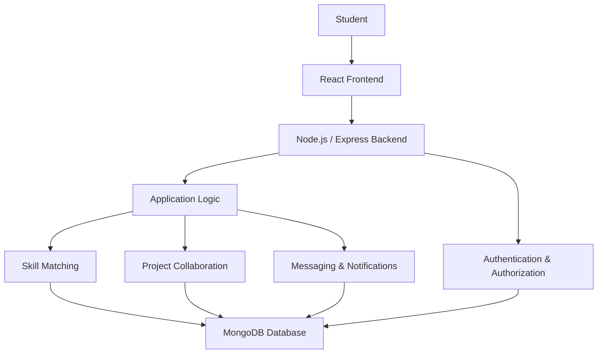
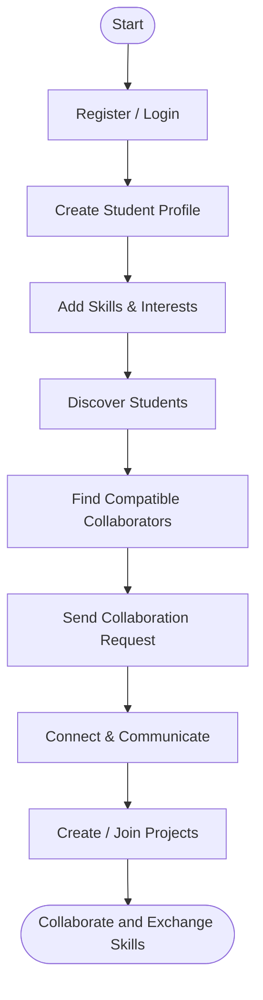

# SkillSwap – Skill-Based Collaboration & Project Partner Finder

### Connect. Collaborate. Exchange Skills. Build Together.

SkillSwap is a MERN-stack web application designed to help students find suitable project partners and collaborators based on their technical skills, interests, and project requirements.

The platform provides a collaborative environment where students can showcase their skills, discover other students, exchange knowledge, create projects, and connect with people who share similar interests.

## Key Features

- **Student Profiles:** Create profiles and showcase technical skills, interests, and experience.
- **Smart Skill Matching:** Discover potential collaborators based on skill compatibility.
- **Student Discovery:** Search and filter students based on their skills and interests.
- **Project Collaboration:** Create projects, invite members, and send join requests.
- **Skill Exchange:** Connect with students to learn and exchange different skills.
- **Messaging:** Communicate with other students.
- **Notifications:** Receive updates about collaboration requests and activities.
- **Admin Dashboard:** Manage platform activities and users.

## System Architecture



## Working Flow



## Technology Stack

| Component | Technologies |
|---|---|
| Frontend | React.js, Vite |
| Backend | Node.js, Express.js |
| Database | MongoDB, Mongoose |
| Authentication | JWT, bcryptjs |
| API Communication | Axios, REST API |
| Routing | React Router |
| Styling | Tailwind CSS |
| Icons | Lucide React |
| Version Control | Git & GitHub |

## Installation & Setup

### 1. Clone the Repository

```bash
git clone <your-github-repository-url>
cd SkillSwap
```

### 2. Install Dependencies

Install frontend dependencies:

```bash
cd client
npm install
```

Install backend dependencies:

```bash
cd ../server
npm install
```

### 3. Configure Environment Variables

Create a `.env` file inside the backend directory and configure the required environment variables.

Example:

```env
PORT=5000
MONGO_URI=your_mongodb_connection_string
JWT_SECRET=your_secret_key
```

Use the actual environment variable names expected by your backend configuration.

### 4. Run the Application

Start the backend:

```bash
cd server
npm run dev
```

Start the frontend in another terminal:

```bash
cd client
npm run dev
```

## Project Structure

```text
SkillSwap/
│
├── client/
│   └── src/
│       ├── components/
│       ├── pages/
│       ├── layouts/
│       ├── hooks/
│       ├── services/
│       ├── context/
│       └── assets/
│
├── server/
│   ├── config/
│   ├── controllers/
│   ├── middleware/
│   ├── models/
│   ├── routes/
│   └── utils/
│
└── README.md
```

*The structure represents the planned application organization; update it to match the actual repository.*

## Project Objectives

- Build a student-focused collaboration platform.
- Connect students based on skills and interests.
- Encourage peer-to-peer learning and knowledge exchange.
- Simplify project partner discovery.
- Provide an environment for collaborative project development.

## Author

**Yuvaraj D**

AI & Data Science | Artificial Intelligence | MERN Stack Development

GitHub: https://github.com/Yuvaraj471

## License

This project is developed for educational and collaborative purposes.
